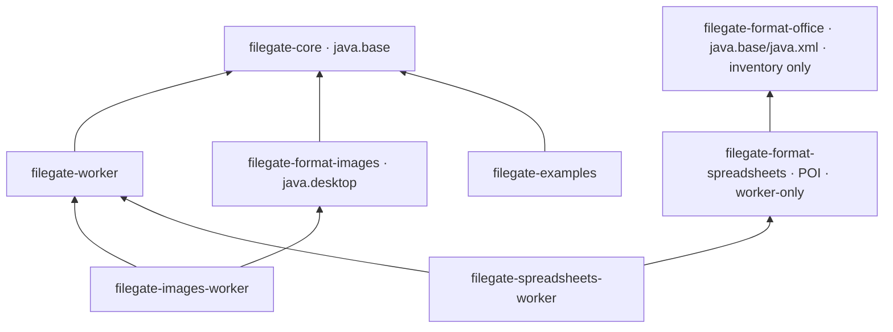

# Architecture and package boundaries

FileGate separates acceptance contracts from artifact ownership, check execution
and platform-specific workers. The public API describes policy, evidence and
scoped content. Non-exported implementation packages own stages, leases, scheduling
and cleanup. Optional format code does not enter the core runtime.

## Artifact dependencies

Core is framework-independent and has no third-party runtime dependency. Worker
and image artifacts are independently installable. The image parser artifact has
no dependency on process supervision. The image-worker adapter assembles those
capabilities explicitly. Examples implement host-owned persistence and depend on
the image worker only for integration tests. JUnit is a test dependency.

The Office package reader is independent of core and currently supplies inventory
only. It is not a registered DOCX/XLSX inspector. Its ZIP and XML collaborators
are non-exported. See [the envelope and remaining checks](office-package-profile.md).

## Public core packages

| Package under `dev.filegate.core` | Responsibility | Main contracts |
| --- | --- | --- |
| root | Gate construction, policy replacement and lifecycle delegation | `FileGate` |
| `policy` | Immutable acceptance definitions and resolved capability identity | `PolicySpec`, `CompiledPolicy`, `CheckDescriptor`, `Use`, `ExecutionMode` |
| `inspection` | Outcomes, evidence, reports and untrusted input claims | `Inspection`, `Approved`, `Blocked`, `InspectionReport`, `CheckEvidence`, `InputClaims` |
| `spi` | Explicitly installed check implementations and scoped input access | `InspectionCheck`, `IsolatedInspectionCheck`, `PrefixInspectionCheck`, `InspectionInput` |
| `content` | Captured identity and verified release contracts | `ArtifactIdentity`, `ApprovedContent`, `TransferReceipt`, `TransferException` |
| `resource` | Per-domain resource configuration and aggregate usage | `ResourceLimits`, `ResourceUsage` |
| `preflight` | Bounded candidate recognition and claim consistency | `PreflightCheck`, `PreflightRules`, `CandidateRecognition` |

Only these packages are exported by `module-info.java`. Result and content
capabilities are sealed interfaces whose issuing implementations are hidden.
Consumers can inspect reports and copy approved content but receive no stage path
or public capability constructor. Reports are immutable data; constructing a
report does not issue an approved-content handle.

These are named-module encapsulation boundaries. The host JVM and same-privilege
processes remain trusted, as required by the proposal; package organization is
not a hostile-code sandbox.

## Core execution and ownership

| Internal collaborator | Owns |
| --- | --- |
| `CheckRegistry` | Explicit plugin identities, startup validation and immutable bound plans |
| `BoundPrefixCheck` | Frozen prefix identity and byte budget, independent of later plugin metadata changes |
| `InspectionEngine` | Coordination of one captured artifact through checks and result issuance |
| `CheckRunner` | Sequential full-content checks and scoped inspector inputs |
| `CheckInvocation` | Shared translation of exceptions, cancellation and malformed plugin evidence |
| `EvidenceAggregator` | Required evidence, verdict precedence and immutable reports |
| `StageStore` | Private filesystem stages, deletion tracking and retained disk charges |
| `CaptureReader` | Fixed-buffer byte counting, hashing and input ceilings |
| `CapturePrefix` | Per-operation bounded prefix state and early checks |
| `CapturedArtifact` | Result ownership, active-reader leases and deletion eligibility |
| `ResourceLedger` | Atomic nonblocking operation and byte reservations |
| `VerifiedContent` | Use-bound, digest/length-verified copy and receipt issuance |
| `PolicyFingerprint` | Versioned canonical encoding of the resolved policy |

`FileGate` binds a plan at construction or reload. Each operation takes one
snapshot, including Path input and source failure handling. `InspectionEngine`
coordinates the workflow; it does not compile policy or manipulate raw stage
paths. `StageStore` delegates the stream loop to `CaptureReader` and accepts the
bounded prefix SPI without depending on a concrete format checker.

Capture returns either `CaptureResult.Captured` or `CaptureResult.Denied`. There is
no success/failure combination represented by null fields. Approved content is
issued only after complete evidence. Closing a result stops new copies; active
copies retain their leases. Reservation release still follows physical deletion.

## Extension boundaries

Implement `InspectionCheck` for an explicitly trusted embedded check. Implement
`PrefixInspectionCheck` when the check needs a bounded initial prefix; declare its
maximum bytes and PREFLIGHT capability kind. The registry validates the bound
before traffic, and early results pass through the same failure translation as
full-content checks. Merely implementing either interface does not add it to an
existing compiled policy. Signatures alone cannot satisfy a content policy.

Use concrete internal collaborators for single implementations. New abstractions
need an actual substitution or ownership boundary. Keep parser dependencies in
format artifacts, execution code in the worker, publication in host adapters and
format-independent acceptance in core.

## Worker boundaries

`dev.filegate.worker.protocol` owns versioned frames, complete request binding
and bounded evidence. `process` owns worker admission and task outcomes. `linux`
owns the supported Docker/cgroup-v2 deployment and its effective restriction probe.
The worker module exports those three packages and keeps process implementation
helpers private to the module.

`WorkerPool` delegates stream tasks to `WorkerExchange` and cleanup to
`ProcessTermination`. All stream phases share a monotonic `TaskDeadline`.
`RestartBackoff` is shared by process and container admission. `WorkerRun` is either
`Completed` or `Failed`; a completed transport task is not content approval.

`ContainerSpec` is validated configuration. `DockerCommands` translates it into
fixed arguments, and `DockerControl` owns finite daemon operations. The runtime
owns admission, startup probing and confirmed container removal. Killing the CLI
still does not establish container termination. The wire encoding and containment
requirements are unchanged by the package refactor.

## Image boundaries

`RestrictedImageInspector` selects the supported image profile and maps findings
to evidence. Hidden `PngParser` and `JpegParser` implementations own their respective
format rules. `PngScanlines` owns bounded inflation and exact zlib postconditions.
`ImageDimensions` centralizes shared geometry ceilings. `JdkImageDecoder` owns
reader selection, decoding, warning checks and reader/pixel cleanup.

The image module exports only `dev.filegate.formats.images`. Parser and decoder
implementation types are not exported. Current coverage is documented in
[image-profile.md](image-profile.md). Connecting this profile to an isolated gate
executor remains roadmap work; the architectural cleanup adds no new format or
production-safety claim.

## Source migration and validation

This pre-release cleanup changes source imports. `FileGate` stays at
`dev.filegate.core.FileGate`; policy types move to `.policy`, results and evidence
to `.inspection`, check plugins/input to `.spi`, transfer types to `.content`, and
resource settings to `.resource`. Preflight types move to `.preflight`. Worker
imports move into `.protocol`, `.process` or `.linux`. Match `WorkerRun.Completed`
or `WorkerRun.Failed` to access its typed payload.

Tests use dedicated fixtures rather than helpers on other test classes. Real
consumer compilation checks exported contracts and rejection of internal imports.
Existing capture, quota, lease, transfer, worker, containment and format tests
remain the behavioral evidence. Preserve the existing Eclipse formatting. The
incompatible Google Java Format check is removed; automated formatting awaits a
shared exported Eclipse profile.

## Shared isolated adapters and worker input

`IsolatedWorkerCheck` owns host-side policy/request/evidence binding for the format
adapters. `IsolatedImageCheck` and `IsolatedSpreadsheetCheck` assemble immutable
profile descriptors and fixed worker programs. They share the same final Linux
runtime and never run parsers in the host. `WorkerInput` owns worker-side bounded
capture, read-only input, post-inspection identity checks and scratch cleanup.
Workbook semantics, formula operand checks, defined-name graphs, package roles and
schema validation have separate non-exported collaborators in the spreadsheet
artifact. Only profiles, reports, violations and the worker-only facade are exported.
